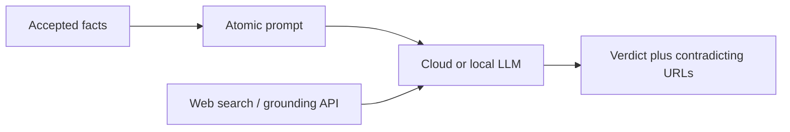

# AI search conflict provenance

How we check approved Fact DB claims against what web-grounded models retrieve, and how we estimate cost.

Day-to-day listing audits (Yext / GBP / first-party) remain in [`.cursor/skills/property-fact-audit/SKILL.md`](../.cursor/skills/property-fact-audit/SKILL.md). Scheduled site/GMB verification design is in [fact-verification-at-scale.md](fact-verification-at-scale.md). This document covers the **AI-answer provenance** track: where conflicting answers come from (every domain+path), so sources can be fixed.

## Goal

For each accepted SoT claim, ask a search-backed model what the web currently says. When it disagrees, collect **all** URLs that support the conflicting value — not only the top hit, and not filtered by first / second / third party.

## Working method (from smoke)

| Choice | Default | Why |
| --- | --- | --- |
| Model | `gpt-5.6-luna`, effort `medium` | ~6× cheaper than Sol on the same pack; atomic Luna also surfaced a real phone conflict Sol missed |
| Batching | **Atomic** for provenance runs | Per-page / property-brief are cheaper but missed or thinned conflicts in smokes |
| Repetitions | **`--repeats 5`** per fact | Single-shot contradicts and matches both flip; use `ever_contradicts` + unioned sources |
| Ops signal | `ever_contradicts` after ×5 | Majority alone buried a real MKT phone conflict |

Hybrid still valid for sweeps: cheap per-page pass, then atomic ×5 only on high-severity / thin / unstable topics.

## Prompt contract

Shared schema: [audits/ai-search/PROMPT_CONTRACT.md](../audits/ai-search/PROMPT_CONTRACT.md).

Per claim: `fact_id`, `model_answer`, `verdict`, `cited_urls`, `contradicting_sources` (full list on `contradicts`), `notes`.

With repeats, the runner aggregates by `fact_id`: majority verdict, `contradict_rate`, `stability`, union of sources, `ever_contradicts`.

## Tooling

| Script | Role |
| --- | --- |
| `scripts/build-ai-search-prompts.mjs` | Build atomic / per-page / property-brief prompts from a pack |
| `scripts/run-ai-search-openai.mjs` | OpenAI Responses API + `web_search`; `--repeats`, retries, checkpoint resume |
| `scripts/score-ai-search.mjs` | Score result folders vs a pack |

Example:

```bash
export OPENAI_API_KEY=…   # valid key; do not commit
node scripts/build-ai-search-prompts.mjs audits/ai-search/sanfrancisco-market/smoke/pack.json
./audits/ai-search/sanfrancisco-market/smoke/run-luna-atomic-x5.sh
```

Outputs live under `audits/ai-search/<property>/`.

## Measured costs (Luna atomic ×5)

Smoke: 12 Market Street facts × 5 trials = 60 calls (`gpt-5.6-luna`, medium, OpenAI `web_search`).

| | Amount |
| --- | ---: |
| Est. total | **~$0.85** |
| Per fact (×5) | **~$0.071** |
| Token share | ~20% (`$0.20` / `$1.20` per 1M in/out) |
| Web search share | **~80%** (`$10` / 1k calls ≈ `$0.01`/call) |

Extrapolated to accepted SoT only (same unit cost):

| Property | Accepted facts | Est. Luna atomic ×5 |
| --- | ---: | ---: |
| Four Seasons Hotel San Francisco (Market) | ~63 | **~$4.40** |
| Four Seasons Hotel San Francisco at Embarcadero | ~56 | **~$4.00** |
| Both | ~119 | **~$8.40** |

Sequential wall time ~45–50 minutes per property at smoke pace. Retries and union passes are extra.

Evidence: [audits/ai-search/sanfrancisco-market/smoke/LUNA_ATOMIC_X5.md](../audits/ai-search/sanfrancisco-market/smoke/LUNA_ATOMIC_X5.md), [LUNA_VS_SOL.md](../audits/ai-search/sanfrancisco-market/smoke/LUNA_VS_SOL.md), [OPENAI_COST_BENEFIT.md](../audits/ai-search/sanfrancisco-market/smoke/OPENAI_COST_BENEFIT.md).

## Local inference as an alternative

Viable as a **model** substitute; not a substitute for **grounding**.



| Layer | Cloud Luna + OpenAI web_search (current) | Local LLM + separate search |
| --- | --- | --- |
| Generation / JSON | Paid (small share of $ today) | Free after hardware (VRAM, ops) |
| Grounding | OpenAI `web_search` (~`$0.01`/call; dominated Luna ×5) | Still required for live URLs — SerpApi, Brave, Bing, DataForSEO, etc. |
| Without any search | Model invents or uses stale weights | Same failure: no trustworthy `contradicting_sources` |

**Do you pay extra for grounding locally?** Usually yes — unless you already have an unlimited crawl/search stack. Local inference removes the Luna token bill; it does **not** remove the need to fetch live results. Given ~80% of measured cost was search calls, swapping only the LLM saves a minority of spend unless search is also cheaper or self-hosted.

**When local is attractive**

- You already pay for a search API (or Lumar / SerpApi / DataForSEO is in use) and can pass result snippets into a local model.
- Hardware is free capacity and you want to avoid OpenAI model rates / data path.
- Offline re-scoring of **cached** search result sets (no new grounding fee).

**When it is a weak fit**

- Expecting “free” end-to-end provenance with no search product — that cannot meet the “all contradicting URLs” goal.
- Needing Instant ChatGPT / Gemini product behaviour specifically (different retrieval stack).
- No ops capacity for GPU hosts, prompt regression, or JSON reliability at Luna’s bar.

**Practical hybrid:** keep OpenAI (or another hosted) search-backed path for high-severity NAP until a local+search pipeline matches ×5 stability on the same smoke pack. Cost optimisation priority is **cheaper or fewer search calls** (dedupe queries, cache SERPs across the five trials, or a lower-priced search API), not only local weights.

## What not to do

- Scale on turn count alone (tokens + search fees matter more).
- Trust single-shot verdicts for phones / hours / ratings.
- Keep only the “most prominent” contradicting source.
- Treat local inference without grounding as equivalent to this audit.
